# PENETRATION TESTING REPORT

### Footprinting & Network Scanning Phases

**W2-PM-FINAL | CYBERSECURITY & ETHICAL HACKING INTERNSHIP | NETWORKWALKS**

| Field | Detail |
| --- | --- |
| **Name** | Erica Gyamfuaa Fordjour |
| **Program/Batch** | Networkwalks Cybersecurity & Ethical Hacking Internship, B084 |
| **Date** | 11 November 2026 |
| **Modules completed** | W2-PM1 (Footprinting with 6 Kali tools)<br>W2-PM4 (theHarvester footprinting)<br>W2-PM5 (Zenmap network scanning) |
| **Targets** | 1. networkwalks.com (assigned in the PM1 task)<br>2. microsoft.com (assigned in the PM4 task, passive public sources only)<br>3. My own home network (192.168.0.0/24) |
| **Permission secured?** | Yes |
|  **Phases covered** | Phase 1: Reconnaissance & Footprinting <br> Phase 2: Scanning & Network Discovery <br> Phase 3-5: In Progress|
| **Lab** | Kali Linux 2026.2 in VirtualBox 7.2.22 (Week 1 lab); Windows 11 host for Zenmap |

---

## 1. Liability Disclaimer

I have performed these activities only on the systems & devices where I had secured written permission or the devices/systems that I own myself. All these materials are for education and research purpose only. Do not use anything from here to break the law. 
Active tools (WHOIS, WhatWeb, Nslookup, Curl, Wafw00f, DNSRecon) were used only on the domain assigned in the program task. The theHarvester work used public data sources only and did not send scans to microsoft.com. The network scan was done only on my own home network. Do not use these techniques on systems you do not own or have permission to test. Unauthorized access is illegal.


## 2. Introduction

This report covers foot printing the networkwalks.com domain using multiple Kali Linux tools (W2-PM1) and scanning my own local network with Zenmap (W2-PM5). One module covers the footprinting phase and the other covers the scanning phase, so together they show how an attacker moves from gathering public information to mapping live hosts on a network. All commands were run in Kali Linux (footprinting), harvesters on kali Linux and on a Windows PC with Zenmap installed (scanning).

It is the Week 2 part of my ongoing internship program at Networkwalks.
- **W2-PM1:** footprinting `networkwalks.com` with six Kali Linux tools.
- **W2-PM4:** collecting emails and subdomains for `microsoft.com` with theHarvester.
- **W2-PM5:** finding live hosts on my own network with Zenmap.


## 3. Tools Used

| Tool | Purpose |
| --- | --- |
| Kali Linux 2026.2 | Attacker machine for footprinting |
| Windows 11 | Host used for Zenmap scanning |
| WHOIS | Domain registration details (owner, dates, name servers) |
| WhatWeb | Identify web technologies (server, CMS, plugins, IP) |
| Nslookup | Resolve a domain to an IP address using DNS |
| Curl `-I` | Read HTTP response headers |
| Wafw00f | Detect a Web Application Firewall |
| DNSRecon | List DNS records (NS, MX, SPF, TXT, SRV) |
| theHarvester 4.10.1 | Collect emails, subdomains and hosts from public sources |
| Zenmap 7.991 (Nmap GUI) | Find live hosts and draw a network topology |
| ipconfig | Find local IP, mask and gateway |

## 4. Activities Performed

### 4.1 Footprinting & Reconnaissance (networkwalks.com)
I performed reconnaissance against the networkwalks.com domain using six Kali Linux tools: WHOIS, WhatWeb, Nslookup, Curl, Wafw00f and DNSRecon. Each tool was used to collect a different type of information about the target.

#### Tool 1: WHOIS

```
whois networkwalks.com
```

| Item | Result |
| --- | --- |
| Registrar | GoDaddy.com, LLC |
| Created | 2019-11-06 |
| Last updated | 2025-11-12 |
| Expires | 2027-11-06 |
| Name servers | NS6135.HOSTGATOR.COM, NS6136.HOSTGATOR.COM |
| DNSSEC | Unsigned |
| Domain locks | Delete, renew, transfer and update prohibited |

**Why it matters:** the name servers point to HostGator, so the site is likely hosted there. The domain locks help stop unauthorized transfers. No registrant details were shown, so privacy protection is likely on.

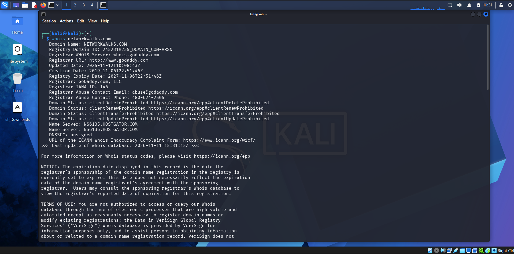

#### Tool 2: WhatWeb

```
whatweb networkwalks.com
```

| Item | Result |
| --- | --- |
| Web server | Apache |
| CMS | WordPress 7.1.4 |
| Plugin | WordPress Download Manager 3.3.76 |
| Libraries | jQuery 3.7.1, Google Tag Manager |
| IP address | 192.232.216.135 |
| Redirect | HTTP 301 to HTTPS, then 200 OK |
| Email shown | info@networkwalks.com |

**Why it matters:** CMS and plugin versions are visible. An attacker can use them to look for known issues in that software.

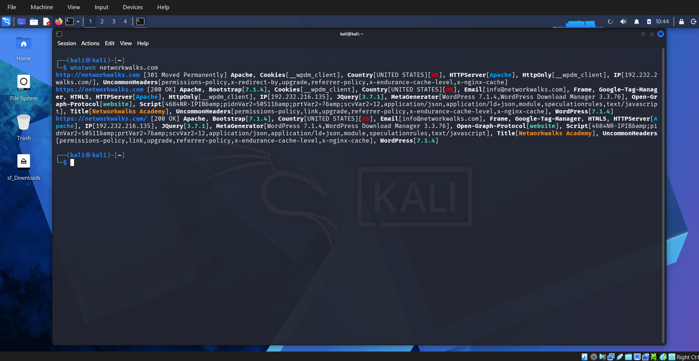


#### Tool 3: Nslookup

```
nslookup networkwalks.com
```

Result: the domain resolves to **192.232.216.135** (non-authoritative answer from 8.8.8.8). This matches the WhatWeb IP.

**Why it matters:** it confirms the real server IP, which is the starting point for further testing.

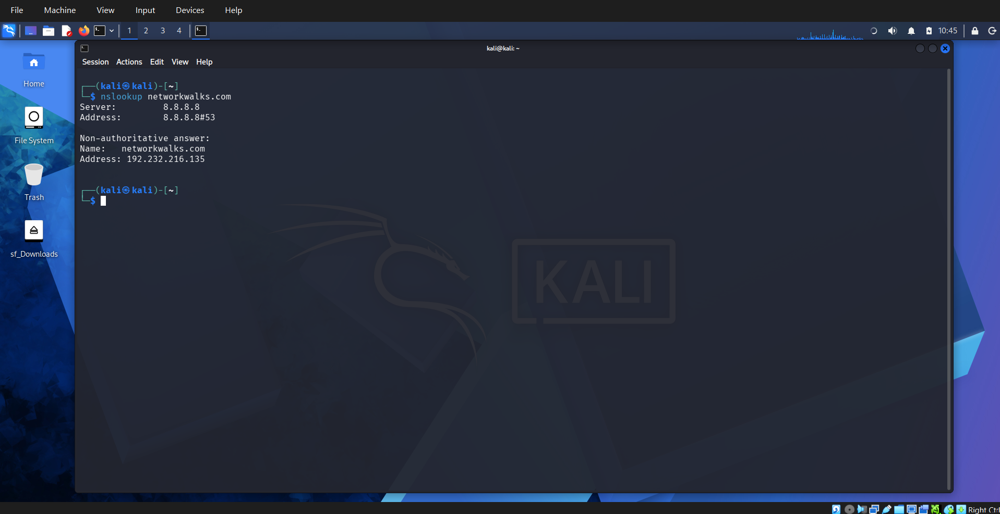


#### Tool 4: Curl

```
curl -I https://networkwalks.com
```

| Item | Result |
| --- | --- |
| Status | HTTP/2 200 |
| Server | Apache |
| WordPress API | `/wp-json/` shown in the `link` header |
| Cookie | `__wpdm_client` with `secure` and `HttpOnly` |
| Headers present | Permissions-Policy, Referrer-Policy |
| Cache headers | `x-nginx-cache`, `x-endurance-cache-level` |
| Headers not seen | Strict-Transport-Security, X-Frame-Options, Content-Security-Policy, X-Content-Type-Options |

**Why it matters:** headers confirm the technology. The missing security headers are an observation to review. A HEAD request may not show every header, so this is not a confirmed weakness.

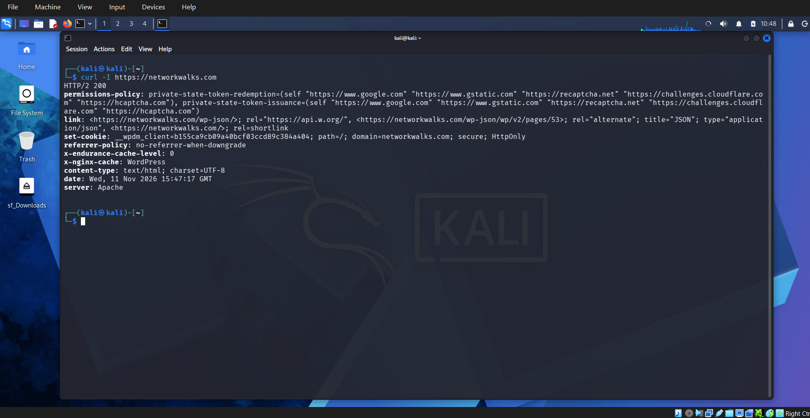


#### Tool 5: Wafw00f

```
wafw00f https://networkwalks.com
```

Result: the site is behind the **ModSecurity (SpiderLabs)** WAF, found in 2 requests.

**Why it matters:** a WAF blocks many basic web attacks. Knowing which WAF is used helps an attacker plan.

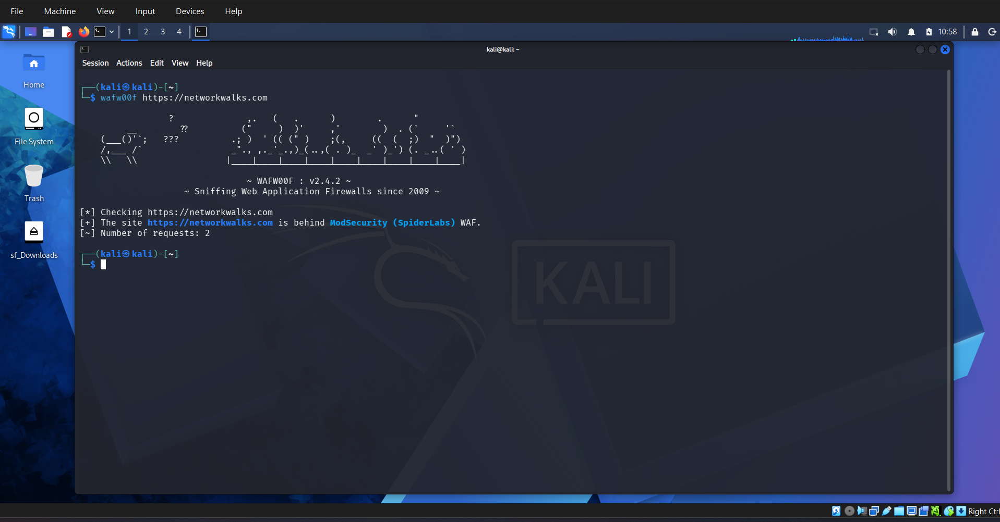


#### Tool 6: DNSRecon

```
dnsrecon -d networkwalks.com
```

| Record | Result |
| --- | --- |
| SOA | ns6135.hostgator.com (50.87.144.87) |
| NS | ns6135.hostgator.com, ns6136.hostgator.com (192.232.216.131) |
| MX | mail.networkwalks.com (192.232.216.135) |
| A | networkwalks.com (192.232.216.135) |
| SRV | `_autodiscover._tcp` to cpanelemaildiscovery.cpanel.net (8 records) |
| DNSSEC | No answer to the query |

**Why it matters:** the web and mail servers share one IP. The SRV records show cPanel hosting. This gives a map of the DNS setup.

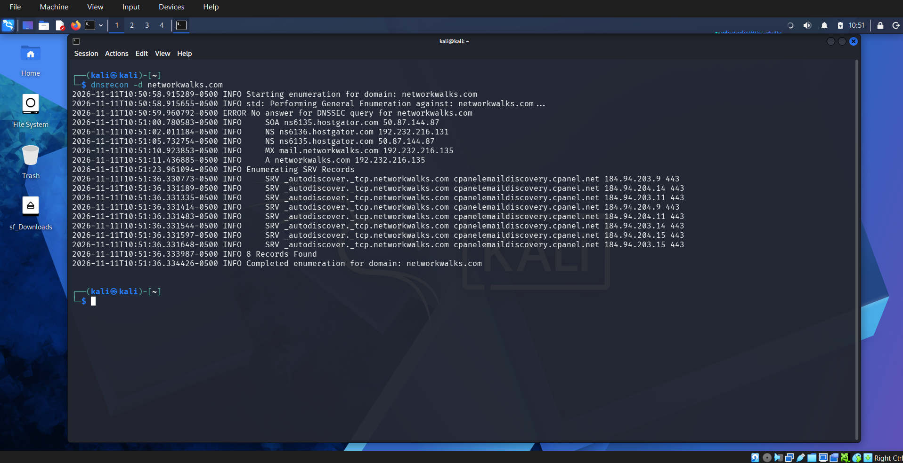


### 4.2 theHarvester on microsoft.com

theHarvester is passive. It reads public sources and does not scan the target.

#### Task 1: Baidu, limit 1000

```
theHarvester -d microsoft.com -l 1000 -b baidu
```

Result: no IPs, emails, people or hosts. The run completed without errors. This only means Baidu returned nothing, not that Microsoft has no emails or subdomains.

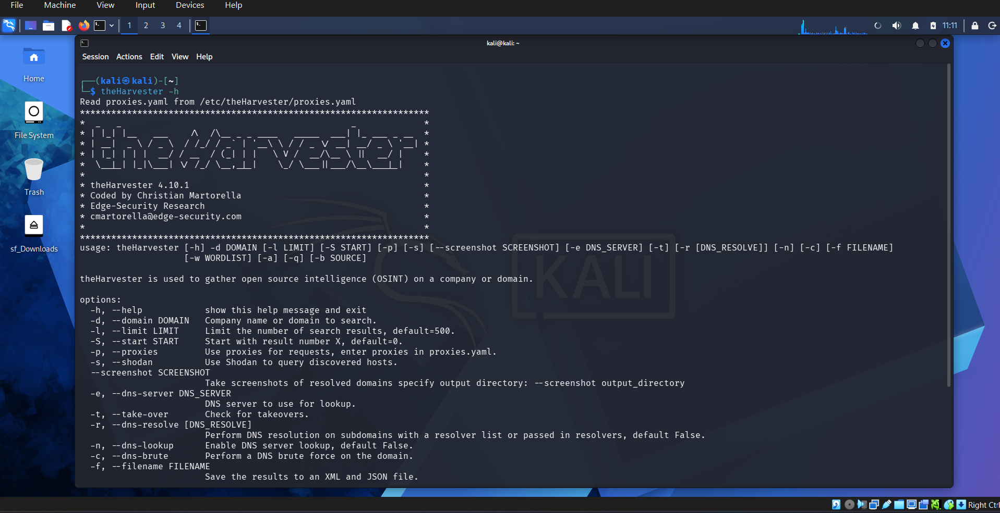

#### Task 2: All sources, limit 50

```
theHarvester -d microsoft.com -l 50 -b all
```

| Item | Result |
| --- | --- |
| Hosts found | 763 |
| Emails | 0 |
| People / LinkedIn | 0 |
| Missing API keys | About 30 sources (for example Shodan, Hunter, Censys, VirusTotal) |
| Source errors | Chaos, Fofa, LeakIX, Robtex, ThreatCrowd, THC |
| Hudson Rock | 44 hosts from employee URLs |

Example subdomains: `azure.microsoft.com`, `learn.microsoft.com`, `careers.microsoft.com`, `support.microsoft.com`, `techcommunity.microsoft.com`.

**Why it matters:**
- Public sources alone gave a large list of hosts.
- Many names look like old or test systems (names with `test`, `ppe` or `staging`). Old names left in public DNS are worth reviewing.
- The `-l 50` limit applies per source, so the total was higher than 50.
- Some results are noisy, such as `2Fblogs.microsoft.com`, where `2F` is a URL-encoded slash.

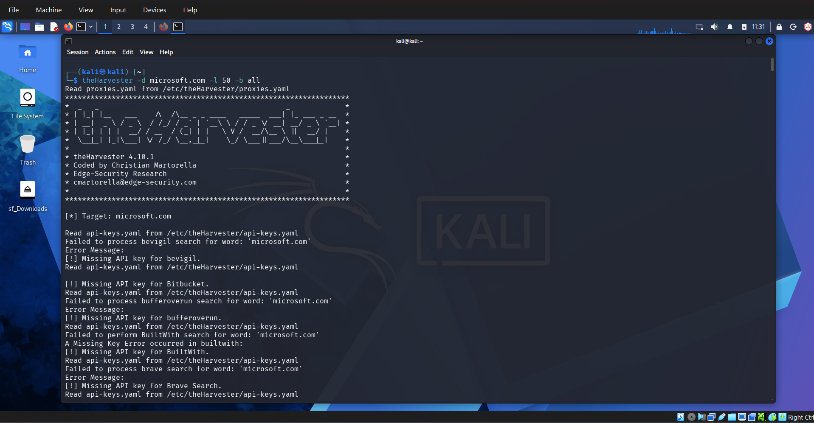


### 4.3 Network scanning with Zenmap

For the second activity, I used Zenmap to perform network discovery on my local network. The practical required me to identify my local IP address and subnet, discover live hosts, identify their IP and MAC addresses, and generate a network topology.

#### Task 1: Install Zenmap

Downloaded Nmap from nmap.org and installed it with the Zenmap component. Version: **Zenmap 7.991**.

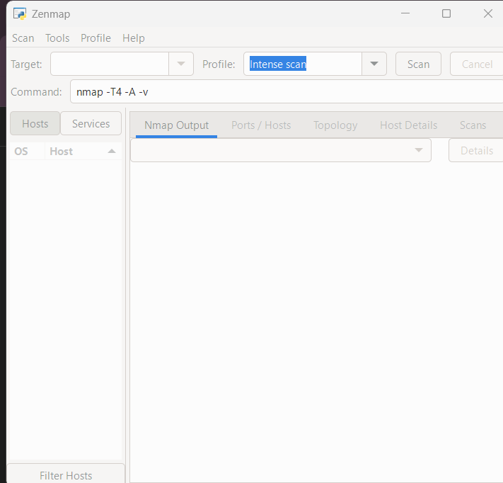


#### Task 2: Find IP and subnet

```
ipconfig
```

| Item | Result |
| --- | --- |
| IPv4 address | 192.168.0.114 |
| Subnet mask | 255.255.255.0 |
| Default gateway | 192.168.0.1 |
| Subnet | 192.168.0.0/24 |

Subnet method: the mask 255.255.255.0 keeps the first three parts of the IP fixed. I set the last part to 0 and added the /24 prefix.

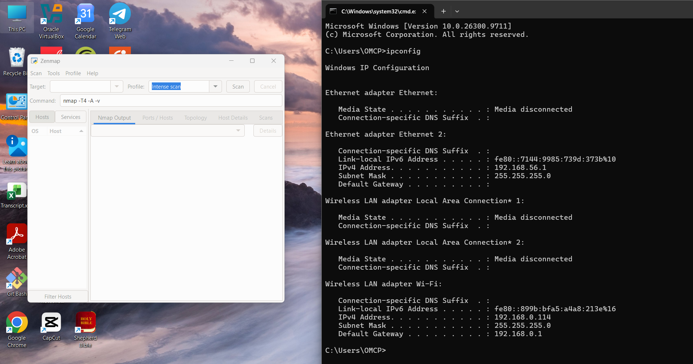


#### Tasks 3 to 6: Live hosts

Target `192.168.0.0/24`, profile **Ping scan**.

Result: **4 hosts up** out of 256 addresses, scanned in 4.38 seconds.

| # | IP address | MAC address (masked) | Vendor | Likely device |
| --- | --- | --- | --- | --- |
| 1 | 192.168.0.1 | B4:1C:30:xx:xx:xx | ZTE | Router (gateway) |
| 2 | 192.168.0.133 | 14:B5:CD:xx:xx:xx | Liteon Technology | Unidentified |
| 3 | 192.168.0.187 | 14:B5:CD:xx:xx:xx | Liteon Technology | Unidentified |
| 4 | 192.168.0.114 | Not shown | n/a | My own PC |

**Why it matters:** an unknown device on a network should be checked. Nmap does not show a MAC for the machine it runs on. Only devices that answer pings appear.

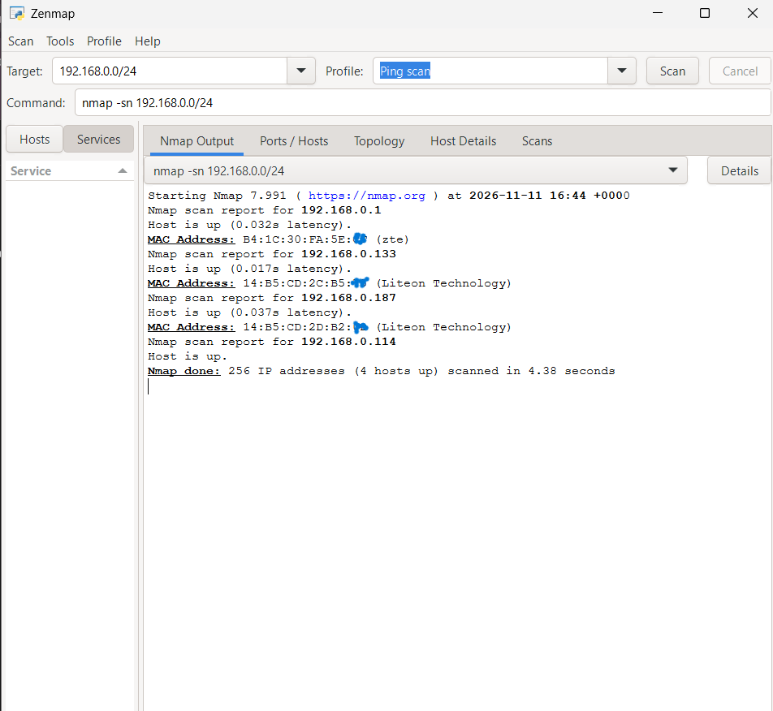

#### Task 7: Topology

The topology was saved as a PDF on the desktop with the legend enabled: `zenmap_topology.pdf`.

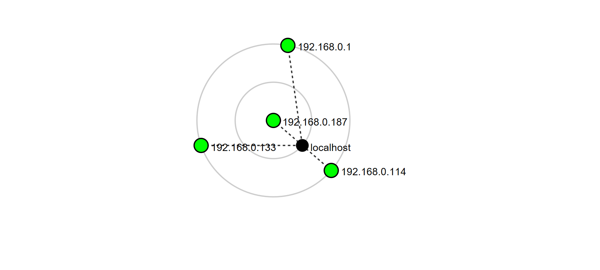


## 5. Risk Analysis / Impact

These are observations from information gathering. They are not confirmed vulnerabilities. No exploitation was done.

| # | Observation | Evidence | Potential impact | Level |
| --- | --- | --- | --- | --- |
| 1 | CMS and plugin versions visible | WhatWeb: WordPress 7.1.4, WPDM 3.3.76 | Helps an attacker research known issues | Medium |
| 2 | WordPress API endpoint exposed | Curl: `/wp-json/` in headers | Helps map the site | Low |
| 3 | Some security headers not seen | Curl: no HSTS, CSP, X-Frame-Options | May leave browser protections unused | Low |
| 4 | DNS and mail setup visible | DNSRecon: NS, MX, SRV records | Helps build an infrastructure profile | Low |
| 5 | DNSSEC not signed | WHOIS and DNSRecon | Weaker protection against DNS spoofing | Low |
| 6 | Many old or test hostnames public | theHarvester: 763 hosts | Forgotten systems may be unpatched | Medium |
| 7 | Unidentified devices on home network | Zenmap: 2 unknown Liteon devices | Unknown devices need to be verified | Medium |

## 6. Recommendations
Based on the observations from these activities, I recommend the following security improvements:

1. **Limit version exposure.** Hide CMS and plugin versions where possible.
2. **Keep software updated.** Update WordPress, plugins and server software often.
3. **Add security headers.** Review HSTS, CSP, X-Frame-Options and X-Content-Type-Options.
4. **Review the WordPress API.** Restrict `/wp-json/` if it is not needed.
5. **Keep the WAF tuned.** ModSecurity is a good layer, but needs good rules.
6. **Clean up DNS.** Remove old test and staging names from public DNS.
7. **Consider DNSSEC.** Sign the domain if the registrar supports it.
8. **Check your own network.** Identify every device and remove unknown ones.
9. **Test with permission only.** Scan only systems you own or are allowed to test.

## 7. Conclusion

In Week 2, I footprinted a domain with six Kali tools, collected public host data with theHarvester, and found live hosts on my own network with Zenmap.

Key lessons:
- Each tool shows a different part of the picture. WHOIS shows ownership, WhatWeb shows technology, DNSRecon shows DNS records, and theHarvester shows how many hosts are public.
- A tool with no results is still a result. Baidu returned nothing, and many theHarvester sources needed API keys.
- Network problems can look like target problems. Wafw00f said the site was down when the real issue was my DNS.
- Findings must be reported as observations. A visible version number is not proof of a vulnerability.
- Always work within permission.


-End-